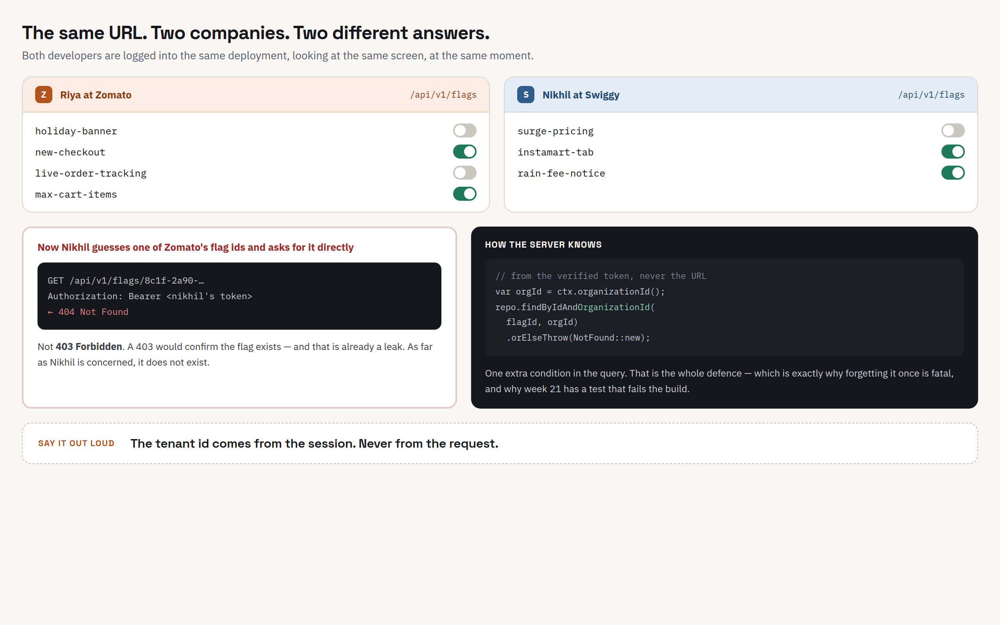
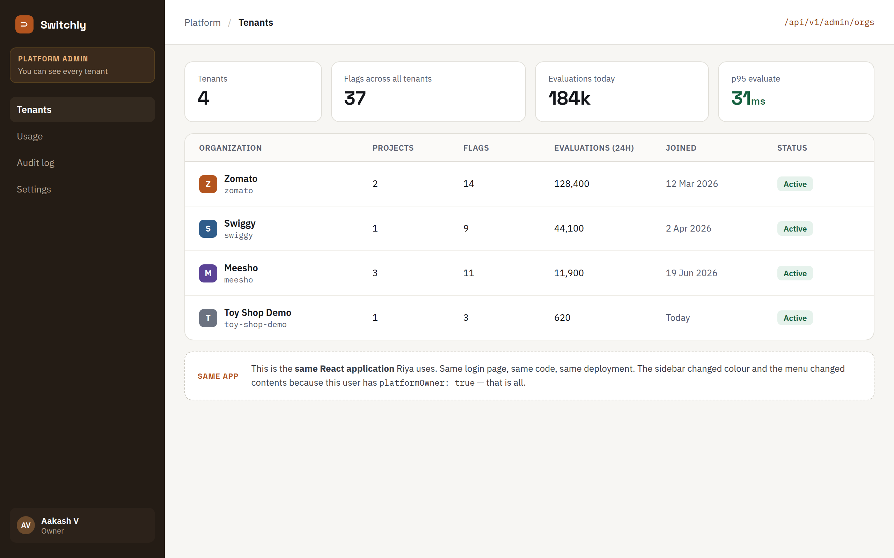

# Session 3A — A real database: Postgres in Docker

**Previous:** [Session 2 — Your first Spring Boot API](02-spring-boot-in-memory-api.md) · **Next:** [Session 3B — Spring Boot meets Postgres](03B-spring-boot-meets-postgres.md)

At the end of session 2 you restarted the app and everything was gone. Zomato, its project, its flag — wiped. Would Zomato pay for a product that forgets them every night?

Today we fix the forgetting. By the end of this session you'll have a real **PostgreSQL** database running on your laptop, the tables for organizations, projects and flags, and some rows in them that survive a restart.

**No Java today.** You won't open the `api` folder at all. Today is just you and the database. In [session 3B](03B-spring-boot-meets-postgres.md), Spring Boot starts writing these rows for you.

| You'll learn to…                                     | Step  |
| ---------------------------------------------------- | ----- |
| Start a database with Docker                         | 2 – 4 |
| Talk to the database directly                        | 5     |
| Design tables from the Java classes you already have | 6 – 7 |
| Create tables, put rows in, read them back           | 8 – 9 |
| Watch the database refuse bad data                   | 10    |
| Prove the data survives a restart                    | 12    |

---

## Step 1 — Why a database?

In session 2, your data lived in a `Map` inside the running Java program. A running program lives in **RAM** — the computer's short-term memory. RAM is fast, but it is wiped the moment the program stops.

A **database** is a program whose whole job is to keep data on **disk**, so it's still there after a restart, a crash, or a power cut. It also lets you ask questions about that data in **SQL** — which you already know.

|                       | `Map` in Java (session 2) | Database (today)                    |
| --------------------- | ------------------------- | ----------------------------------- |
| Where the data lives  | RAM                       | Disk                                |
| After a restart       | Gone                      | Still there                         |
| How you ask questions | Java code                 | SQL                                 |
| Who checks the rules  | Only your Java code       | Your Java code **and** the database |

We'll use **PostgreSQL** (people say "Postgres"). It's free, it's used by real companies everywhere, and it's what Switchly will run on in production.

---

## Step 2 — Docker in four words

We won't install Postgres the normal way. We'll run it inside **Docker**.

> **Why?** Installing Postgres directly means a different installer on Windows and Mac, a password you'll forget, and a background service that runs forever. With Docker, everyone in the class runs **exactly the same Postgres** with **one command** — and removing it later is one command too.

You only need four words today:

| Word          | What it means                                                                               | Everyday version                   |
| ------------- | ------------------------------------------------------------------------------------------- | ---------------------------------- |
| **Image**     | A ready-made package of a program — here, Postgres 17.                                      | The installer you download         |
| **Container** | A running copy of an image.                                                                 | The program, installed and running |
| **Port**      | A numbered door on your laptop that lets you reach the program inside the container.        | A door number                      |
| **Volume**    | A folder Docker keeps on disk for the container. It survives when the container is removed. | An external hard disk              |

That's all the Docker you need today.

### Check Docker is ready

Open **Docker Desktop** and wait until it says it's running. Then, in a terminal:

```bash
docker --version
docker compose version
```

Both should print a version number. If `docker compose` says it isn't a docker command, update Docker Desktop.

If you skipped the session 1 homework, also run this — it should print `Hello from Docker!`:

```bash
docker run hello-world
```

---

## Step 3 — Describe your database in a file

We tell Docker what we want in a file called `docker-compose.yml`. Docker reads it and does the rest.

Create a new folder called `infra` at the **top** of your `switchly` repository — next to `api` and `docs`, **not** inside `api`:

```
switchly/
├── api/
├── docs/
└── infra/        ← new
```

> `infra` is short for _infrastructure_ — the things our code needs in order to run, like a database. Everything that isn't our Java code but is needed to run it will live here.

Inside `infra`, create `docker-compose.yml`:

```yaml
services:
  postgres:
    image: postgres:17
    container_name: switchly-postgres
    environment:
      POSTGRES_DB: switchly
      POSTGRES_USER: switchly
      POSTGRES_PASSWORD: switchly
    ports:
      - "15432:5432"
    volumes:
      - switchly-db-data:/var/lib/postgresql/data

volumes:
  switchly-db-data:
```

> **Spaces matter in YAML.** Use spaces, never tabs, and keep the indentation exactly as shown. A wrong indent is the most common reason this file doesn't work.

What each line means:

| Line                                        | Meaning                                                                                  |
| ------------------------------------------- | ---------------------------------------------------------------------------------------- |
| `services:`                                 | The list of programs we want to run. Just one today.                                     |
| `postgres:`                                 | The name we give this service. We'll use it in commands.                                 |
| `image: postgres:17`                        | Use the official Postgres image, version 17.                                             |
| `container_name: switchly-postgres`         | The name you'll see in Docker Desktop.                                                   |
| `POSTGRES_DB: switchly`                     | Create a database called `switchly` the first time it starts.                            |
| `POSTGRES_USER` / `POSTGRES_PASSWORD`       | The username and password for that database.                                             |
| `"15432:5432"`                              | **Your laptop's** door 15432 leads to **the container's** door 5432. More on this below. |
| `switchly-db-data:/var/lib/postgresql/data` | Keep Postgres's data folder in a volume called `switchly-db-data`, so it survives.       |

### Why `15432` and not `5432`?

Postgres always listens on door **5432** — inside the container, that's still true. But many of you already installed Postgres on your laptop in college, and that one is **already using door 5432** (sometimes 5433 and 5434 too, if you installed more than one version). Two programs can't share a door.

So we map a different door on your laptop — `15432` (easy to remember: a `1` in front of `5432`) — to the container's `5432`:

```
 your laptop                    the container
 ─────────────                  ─────────────────
 door 15432  ─────────────────►  door 5432  →  Postgres
```

> **About that password.** `switchly` / `switchly` is fine for a database that only exists on your laptop. Real passwords never go into a file in git — we'll handle that properly before we deploy.

---

## Step 4 — Start the database

In your terminal, go **into the `infra` folder** and start it:

```bash
cd infra
docker compose up -d
```

- `up` — start everything in `docker-compose.yml`
- `-d` — "detached": run in the background and give me my terminal back

The first time, Docker downloads the Postgres image (around 150 MB), so it takes a minute. The last lines should look like this:

```
 ✔ Network infra_default             Created
 ✔ Volume "infra_switchly-db-data"   Created
 ✔ Container switchly-postgres       Started
```

Check it's running:

```bash
docker compose ps
```

```
NAME                IMAGE         COMMAND                  SERVICE    CREATED          STATUS          PORTS
switchly-postgres   postgres:17   "docker-entrypoint.s…"   postgres   10 seconds ago   Up 10 seconds   0.0.0.0:15432->5432/tcp
```

`STATUS` says `Up`, and `PORTS` shows the door mapping from Step 3.

Look at what Postgres printed while starting:

```bash
docker compose logs postgres
```

The last line should be:

```
switchly-postgres  | ... LOG:  database system is ready to accept connections
```

You can also see the container in **Docker Desktop → Containers**.

> **Every `docker compose` command in this session runs from inside the `infra` folder.** That's where Docker finds `docker-compose.yml`. If you see `no configuration file provided: not found`, you're in the wrong folder.

---

## Step 5 — Talk to the database

Postgres comes with a command-line tool called **`psql`**. You type SQL, it runs it and shows you the result. It's already inside the container, so there's nothing to install.

```bash
docker compose exec postgres psql -U switchly -d switchly
```

- `exec postgres` — run a command inside the `postgres` service
- `psql -U switchly -d switchly` — open psql as user `switchly`, on database `switchly`

You'll see:

```
psql (17.x (Debian ...))
Type "help" for help.

switchly=#
```

That `switchly=#` is the **psql prompt**. From now on, this guide says **"in psql"** for things you type here, and **"in your terminal"** for normal commands.

The psql commands you need:

| Type this  | What it does                                   |
| ---------- | ---------------------------------------------- |
| `\dt`      | List all tables                                |
| `\d flag`  | Show the columns and rules of the table `flag` |
| `\q`       | Quit psql, back to your terminal               |
| `Ctrl + C` | Cancel what you're typing                      |

Commands starting with `\` are psql's own. Everything else is SQL — and **every SQL statement ends with `;`**. If you press Enter and the prompt changes to `switchly-#`, psql is waiting for the `;`. Type `;` and press Enter.

Try it, in psql:

```sql
\dt
```

```
Did not find any relations.
```

A brand-new, empty database. ("Relation" is Postgres's word for a table.)

---

## Step 6 — Design the tables on paper first

Before typing any SQL, decide what the tables look like. Good news: **you already designed them** — in session 2, as Java classes.

| Java (session 2)                                    | Database (today)                 |
| --------------------------------------------------- | -------------------------------- |
| A class — `Organization`                            | A **table** — `organization`     |
| A field — `organizationId`                          | A **column** — `organization_id` |
| One object — `new Organization(...)`                | One **row**                      |
| The whole `Map` in `InMemoryOrganizationRepository` | The whole table                  |
| `UUID`                                              | `UUID`                           |
| `String`                                            | `TEXT`                           |
| `boolean`                                           | `BOOLEAN`                        |

Two naming habits:

- Java uses `camelCase` (`organizationId`); SQL uses `snake_case` (`organization_id`). Same thing, different spelling habits.
- Table names are **singular**: `flag`, not `flags`. A table is "the flag table", and each row is one flag.

> **`TEXT` vs `VARCHAR(255)`.** You may have learned `VARCHAR(n)` in college. In Postgres, `TEXT` is the normal choice for strings — no length to guess, and just as fast.

### Three rules a table can enforce

You already wrote these rules in Java in session 2. The database can enforce them too.

**1. Primary key — "every row has its own unique id."**
`id UUID PRIMARY KEY`. No two rows can share an `id`, and it can never be empty. It's the `Map` key from session 2.

**2. Foreign key — "this column must point at a row that exists."**
A project's `organization_id` must be the `id` of a real organization. In session 2, `ProjectService` checked this in Java and returned **404**. Now the database checks it too.

**3. Unique — "no two rows can have the same value here."**
Two flags in the same project can't share a `key`. In session 2, `existsByProjectIdAndKey` checked this and returned **409**. The database version is `UNIQUE (project_id, key)`.

> **The rules you wrote in Java, the database can enforce too — and it never forgets to.**

### The diagram

Draw this in your notebook. An arrow goes from a foreign key to the primary key it points at.

```
┌───────────────────────┐
│ organization          │
├───────────────────────┤
│ id               PK   │◄──────────┬──────────────┐
│ name                  │           │              │
└───────────────────────┘           │              │
                                    │              │
┌───────────────────────┐           │              │
│ project               │           │              │
├───────────────────────┤           │              │
│ id               PK   │◄───┐      │              │
│ organization_id  FK   │────┼──────┘              │
│ name                  │    │                     │
└───────────────────────┘    │                     │
                             │                     │
┌───────────────────────┐    │                     │
│ flag                  │    │                     │
├───────────────────────┤    │                     │
│ id               PK   │    │                     │
│ organization_id  FK   │────┼─────────────────────┘
│ project_id       FK   │────┘
│ key                   │
│ name                  │
│ enabled               │
└───────────────────────┘

PK = primary key        FK = foreign key
```

Read an arrow as **"belongs to"**: each project belongs to one organization; one organization can have many projects. Each flag belongs to one project.

This kind of drawing is called an **ER diagram** (Entity–Relationship). You'll see them in every company that uses a database.

---

## Step 7 — Wait — why does `flag` have `organization_id`?

Look at the diagram again. A flag points at its project, and the project already knows its organization. So why does `flag` **also** store `organization_id`?

Think back to the hotel from session 1. Every guest's keycard opens **their** room and no one else's.

When Zomato asks for its flags, the database query will look like this:

```sql
SELECT * FROM flag WHERE organization_id = '<Zomato''s id>';
```

That `WHERE organization_id = ...` is the keycard check. It's what stops Swiggy from ever seeing Zomato's flags.

- **With** `organization_id` on `flag`, the check sits right on the table you're reading. One condition. Hard to forget.
- **Without** it, every query would have to join through `project` to find the organization. Forget that join **once**, in **one** query, and one company sees another company's flags.



_From our design screens: the same URL, two companies, two different answers. The whole defence is one extra condition in the query. In session 8 we build exactly this._

Storing the same fact in two places is called **denormalisation**. It's normally something to avoid — but here it's deliberate, because it makes the most important rule in the product easy to get right. The one rule that keeps it safe: **a flag's `organization_id` is set once, when the flag is created, and never changes.**

> **You already did this.** Open `FlagService.create` from session 2. It copies `project.getOrganizationId()` into the new flag. You built this design without knowing its name.

---

## Step 8 — Create the tables

Now type the design into Postgres. Order matters: `project` points at `organization`, so `organization` must exist first. Then `project`. Then `flag`.

In psql, paste this and press Enter:

```sql
CREATE TABLE organization (
    id    UUID PRIMARY KEY,
    name  TEXT NOT NULL
);
```

```
CREATE TABLE
```

`NOT NULL` means "this column can never be empty". Every organization must have a name.

Next, `project`:

```sql
CREATE TABLE project (
    id               UUID PRIMARY KEY,
    organization_id  UUID NOT NULL REFERENCES organization(id),
    name             TEXT NOT NULL
);
```

`REFERENCES organization(id)` is the foreign key: this column must match an `id` in the `organization` table.

And `flag`:

```sql
CREATE TABLE flag (
    id               UUID PRIMARY KEY,
    organization_id  UUID NOT NULL REFERENCES organization(id),
    project_id       UUID NOT NULL REFERENCES project(id),
    key              TEXT NOT NULL,
    name             TEXT NOT NULL,
    enabled          BOOLEAN NOT NULL DEFAULT false,
    CONSTRAINT uq_flag_key_per_project UNIQUE (project_id, key)
);
```

Two new things:

- `DEFAULT false` — if you don't say whether a new flag is on, it's **off**. Same as session 2: a new flag always starts off. Safe by default.
- `CONSTRAINT uq_flag_key_per_project UNIQUE (project_id, key)` — the "no duplicate keys in a project" rule. We give the rule a **name** (`uq_flag_key_per_project`) so that when it's broken, the error message tells us exactly which rule. `uq_` is short for "unique".

Check, in psql:

```sql
\dt
```

```
            List of relations
 Schema |     Name     | Type  |  Owner
--------+--------------+-------+----------
 public | flag         | table | switchly
 public | organization | table | switchly
 public | project      | table | switchly
(3 rows)
```

And look at one table in detail:

```sql
\d flag
```

```
                    Table "public.flag"
     Column      |  Type   | Collation | Nullable | Default
-----------------+---------+-----------+----------+---------
 id              | uuid    |           | not null |
 organization_id | uuid    |           | not null |
 project_id      | uuid    |           | not null |
 key             | text    |           | not null |
 name            | text    |           | not null |
 enabled         | boolean |           | not null | false
Indexes:
    "flag_pkey" PRIMARY KEY, btree (id)
    "uq_flag_key_per_project" UNIQUE CONSTRAINT, btree (project_id, key)
Foreign-key constraints:
    "flag_organization_id_fkey" FOREIGN KEY (organization_id) REFERENCES organization(id)
    "flag_project_id_fkey" FOREIGN KEY (project_id) REFERENCES project(id)
```

Every rule from your diagram is there. Postgres named the ones we didn't name — `flag_pkey`, `flag_project_id_fkey` and so on.

---

## Step 9 — Put data in

Let's do session 2's whole flow — organization → project → flag → turn it on — but in SQL.

### An organization

In psql:

```sql
INSERT INTO organization (id, name) VALUES (gen_random_uuid(), 'Zomato');
```

```
INSERT 0 1
```

`gen_random_uuid()` makes a new random UUID — the SQL version of `UUID.randomUUID()` from session 2. `INSERT 0 1` means "inserted 1 row".

Read it back:

```sql
SELECT * FROM organization;
```

```
                  id                  |  name
--------------------------------------+--------
 a23a998c-60fa-490a-9360-a09134252c06 | Zomato
(1 row)
```

Your `id` will be different. **Copy it** — select it with your mouse and copy, the whole thing.

### A project

Replace `PASTE_ORG_ID` with the id you copied. Keep the single quotes around it.

```sql
INSERT INTO project (id, organization_id, name)
VALUES (gen_random_uuid(), 'PASTE_ORG_ID', 'Consumer App');
```

```sql
SELECT * FROM project;
```

```
                  id                  |           organization_id            |     name
--------------------------------------+--------------------------------------+--------------
 496fdfe5-bf47-4781-ad1e-201a57b2567d | a23a998c-60fa-490a-9360-a09134252c06 | Consumer App
(1 row)
```

Copy the project's `id` too.

### A flag

A flag needs **both** ids: its organization and its project.

```sql
INSERT INTO flag (id, organization_id, project_id, key, name)
VALUES (gen_random_uuid(), 'PASTE_ORG_ID', 'PASTE_PROJECT_ID', 'new-checkout', 'New Checkout');
```

```sql
SELECT * FROM flag;
```

```
                  id                  |           organization_id            |              project_id              |     key      |     name     | enabled
--------------------------------------+--------------------------------------+--------------------------------------+--------------+--------------+---------
 3b90a5d8-279d-49e4-b43d-1126c6d2b2a3 | a23a998c-60fa-490a-9360-a09134252c06 | 496fdfe5-bf47-4781-ad1e-201a57b2567d | new-checkout | New Checkout | f
(1 row)
```

We didn't say anything about `enabled`, so the `DEFAULT false` kicked in: `f` means false. The flag starts **off**.

> **Wide output?** If the table wraps and looks messy, make your terminal window wider, or select fewer columns: `SELECT key, name, enabled FROM flag;`

### Turn it on

```sql
UPDATE flag SET enabled = true WHERE key = 'new-checkout';
```

```
UPDATE 1
```

```sql
SELECT key, enabled FROM flag;
```

```
     key      | enabled
--------------+---------
 new-checkout | t
(1 row)
```

`t` — on.

### Your API, in SQL

Everything your session 2 API did, you just did by hand:

| Session 2 API                      | SQL you just ran                |
| ---------------------------------- | ------------------------------- |
| `POST /api/v1/orgs`                | `INSERT INTO organization ...`  |
| `GET /api/v1/orgs`                 | `SELECT * FROM organization`    |
| `POST /api/v1/projects/{id}/flags` | `INSERT INTO flag ...`          |
| `PUT /api/v1/flags/{id}/state`     | `UPDATE flag SET enabled = ...` |

In session 3B, your API will run these same statements for you. That's all a web API on top of a database is: a polite front door to SQL.

---

## Step 10 — Try to break it

In session 2, you tried to break your API and got 404, 409 and 400. Now try the same things against the database directly.

### A project for an organization that doesn't exist

```sql
INSERT INTO project (id, organization_id, name)
VALUES (gen_random_uuid(), '00000000-0000-0000-0000-000000000000', 'Ghost Project');
```

```
ERROR:  insert or update on table "project" violates foreign key constraint "project_organization_id_fkey"
DETAIL:  Key (organization_id)=(00000000-0000-0000-0000-000000000000) is not present in table "organization".
```

The foreign key refused it.

### The same flag key twice in one project

```sql
INSERT INTO flag (id, organization_id, project_id, key, name)
VALUES (gen_random_uuid(), 'PASTE_ORG_ID', 'PASTE_PROJECT_ID', 'new-checkout', 'New Checkout Again');
```

```
ERROR:  duplicate key value violates unique constraint "uq_flag_key_per_project"
DETAIL:  Key (project_id, key)=(496fdfe5-bf47-4781-ad1e-201a57b2567d, new-checkout) already exists.
```

See how the error names our rule, `uq_flag_key_per_project`? That's why we named it.

### An organization with no name

```sql
INSERT INTO organization (id) VALUES (gen_random_uuid());
```

```
ERROR:  null value in column "name" of relation "organization" violates not-null constraint
DETAIL:  Failing row contains (af0b0eec-ebf4-48b1-b290-55f0fd31222c, null).
```

### Side by side

| What you tried             | Session 2 (your Java code)          | Today (the database)                            |
| -------------------------- | ----------------------------------- | ----------------------------------------------- |
| Organization doesn't exist | `ProjectService` → **404**          | Foreign key → `violates foreign key constraint` |
| Duplicate flag key         | `existsByProjectIdAndKey` → **409** | Unique → `violates unique constraint`           |
| Missing name               | `@NotBlank` → **400**               | `NOT NULL` → `violates not-null constraint`     |

> **One difference worth noticing.** Try an **empty** name:
>
> ```sql
> INSERT INTO organization (id, name) VALUES (gen_random_uuid(), '');
> ```
>
> It works! `NOT NULL` stops a **missing** name, but an empty string `''` is still a value. Your Java `@NotBlank` is stricter. So we keep **both**: Java gives the user a friendly, precise error; the database is the last line of defence. Delete that empty organization:
>
> ```sql
> DELETE FROM organization WHERE name = '';
> ```

Every failed statement above changed **nothing**. When a database refuses a statement, it refuses all of it.

---

## Step 11 — Read across tables with a JOIN

One more query. Show every flag with its project and organization **names**, not just ids:

```sql
SELECT o.name AS organization, p.name AS project, f.key, f.enabled
FROM flag f
JOIN project p      ON p.id = f.project_id
JOIN organization o ON o.id = f.organization_id;
```

```
 organization |   project    |     key      | enabled
--------------+--------------+--------------+---------
 Zomato       | Consumer App | new-checkout | t
(1 row)
```

- `flag f` — "call the flag table `f` for short". Same for `p` and `o`.
- `JOIN project p ON p.id = f.project_id` — "for each flag, find the project whose `id` matches the flag's `project_id`".

The foreign keys are exactly the lines a `JOIN` follows. That's what the arrows in your diagram are for.

---

## Step 12 — Does it survive?

This is the whole point of today. Quit psql:

```sql
\q
```

In your terminal (still in `infra`), **stop and remove** the container:

```bash
docker compose down
```

```
 ✔ Container switchly-postgres  Removed
 ✔ Network infra_default        Removed
```

```bash
docker compose ps
```

The list is empty. The container is gone. Now start it again, and open psql:

```bash
docker compose up -d
docker compose exec postgres psql -U switchly -d switchly
```

In psql:

```sql
SELECT key, enabled FROM flag;
```

```
     key      | enabled
--------------+---------
 new-checkout | t
(1 row)
```

**Still there — and still on.** The container was deleted, but the data lived in the **volume**, and the new container picked it up. Compare that with the end of session 2.

> ⚠️ **Never add `-v` unless you mean it.** `docker compose down -v` also deletes the volume — every table, every row, gone. It's the "erase everything and start fresh" button. Useful sometimes; never by accident.

---

## Step 13 — Before you leave

Quit psql (`\q`). The database keeps running in the background until you stop it. To stop it, in `infra`:

```bash
docker compose down
```

Your data is safe in the volume. Next time, `docker compose up -d` brings it all back. You can also quit Docker Desktop.

**Don't delete your tables or your data.** You need them for the homework, and session 3B starts from here.

---

## Your final structure

Only one new file today:

```
switchly/
├── api/                        (unchanged)
├── docs/
└── infra/
    └── docker-compose.yml      ← new
```

---

## New words

| Word                      | Meaning                                                                                         |
| ------------------------- | ----------------------------------------------------------------------------------------------- |
| **Database**              | A program that keeps data on disk and answers questions about it in SQL.                        |
| **PostgreSQL / Postgres** | The database we use. Free, and used everywhere.                                                 |
| **Docker image**          | A ready-made package of a program, like an installer.                                           |
| **Container**             | A running copy of an image.                                                                     |
| **Port**                  | A numbered door for reaching a program. `15432:5432` = laptop door 15432 → container door 5432. |
| **Volume**                | Disk space Docker keeps for a container. Survives `docker compose down`.                        |
| **psql**                  | Postgres's command-line tool for typing SQL.                                                    |
| **Table / row / column**  | Class / object / field, in database words.                                                      |
| **Primary key (PK)**      | The column that uniquely identifies each row.                                                   |
| **Foreign key (FK)**      | A column that must point at an existing row in another table.                                   |
| **Unique constraint**     | A rule that no two rows can share a value (or a combination of values).                         |
| **ER diagram**            | A drawing of tables and the foreign keys between them.                                          |
| **Denormalisation**       | Storing the same fact in two places on purpose — like `organization_id` on `flag`.              |

---

## If something goes wrong

| You see                                                                         | Fix                                                                                                                                                                                              |
| ------------------------------------------------------------------------------- | ------------------------------------------------------------------------------------------------------------------------------------------------------------------------------------------------ |
| `Cannot connect to the Docker daemon` / `error during connect`                  | Docker Desktop isn't running. Open it and wait until it says it's running.                                                                                                                       |
| `Ports are not available ... address already in use`                            | Something on your laptop already uses door 15432. Change `"15432:5432"` to `"25432:5432"` in `docker-compose.yml` and run `docker compose up -d` again. Remember your new number for session 3B. |
| `no configuration file provided: not found`                                     | You're not in the `infra` folder. `cd infra` first.                                                                                                                                              |
| `yaml: line N: ...` or `mapping values are not allowed`                         | An indentation mistake in `docker-compose.yml`. Use spaces, not tabs; copy the file again.                                                                                                       |
| `service "postgres" is not running`                                             | Run `docker compose up -d` first.                                                                                                                                                                |
| `the input device is not a TTY` (Windows, Git Bash)                             | Run the `psql` command from PowerShell instead, or put `winpty` in front of it.                                                                                                                  |
| You press Enter and nothing happens; prompt shows `switchly-#`                  | psql is waiting for `;`. Type `;` and press Enter.                                                                                                                                               |
| `syntax error at or near "PASTE_ORG_ID"` / `invalid input syntax for type uuid` | You didn't replace the placeholder, or the quotes are missing. The id goes inside single quotes: `'a23a998c-...'`.                                                                               |
| `relation "organization" does not exist`                                        | The table wasn't created. Run `\dt` to see what exists, then create it. Create tables in order: organization, project, flag.                                                                     |
| `relation "organization" already exists`                                        | You created it already. That's fine — move on.                                                                                                                                                   |
| `docker compose` isn't a docker command                                         | Your Docker Desktop is old. Update it.                                                                                                                                                           |
| Your data is gone after a restart                                               | You ran `docker compose down -v`. The `-v` deletes the volume. Create the tables and rows again.                                                                                                 |

---

## Homework

1. **Add a second company.** Insert an organization `Swiggy`, a project `Swiggy App`, and two flags in it: `surge-pricing` and `instamart-tab`. Before you run the `JOIN` from Step 11 again, guess: how many rows will it show? Then run it and check.

2. **Only Swiggy's flags.** Change the `JOIN` query from Step 11 so it shows only Swiggy's flags. Which line did you add? That one line is the keycard from Step 7.

3. **The Owner's screen.** This is the screen the Switchly team sees — one row per company, with how many projects and flags each has:

   

   Write one SQL query that produces the **Organization**, **Projects** and **Flags** columns. Add a third organization with no projects at all (say, `Meesho`) — your query should still show it, with `0` and `0`.

   <details>
   <summary>Hint</summary>

   You need `LEFT JOIN` (so organizations with no projects still appear), `GROUP BY`, and `COUNT`. Be careful: counting projects after joining flags can count the same project more than once — `COUNT(DISTINCT ...)` fixes that.
   </details>

   <details>
   <summary>One answer</summary>

   ```sql
   SELECT o.name AS organization,
          COUNT(DISTINCT p.id) AS projects,
          COUNT(f.id)          AS flags
   FROM organization o
   LEFT JOIN project p ON p.organization_id = o.id
   LEFT JOIN flag f    ON f.project_id = p.id
   GROUP BY o.name
   ORDER BY o.name;
   ```

   ```
    organization | projects | flags
   --------------+----------+-------
    Meesho       |        0 |     0
    Swiggy       |        1 |     2
    Zomato       |        1 |     1
   ```

   </details>

4. **Think, don't code.** Your session 2 code checks `existsByProjectIdAndKey` before saving a flag. The database now has `UNIQUE (project_id, key)`. Isn't one of them enough? Why keep both?

   <details>
   <summary>Answer</summary>

   The Java check gives the user a clear **409** with a friendly message. But imagine two requests to create `new-checkout` arriving at the **same instant**: both run `existsByProjectIdAndKey`, both see "no", and both try to save. Only the database can stop the second one — it checks at the moment of writing, one row at a time. Java gives the nice message; the database gives the guarantee.
   </details>

---

## Checkpoint

- ✅ `docker compose ps` shows `switchly-postgres` with status `Up`.
- ✅ You can open psql and list your tables with `\dt`.
- ✅ You have `organization`, `project` and `flag` tables, and you can say what a primary key, a foreign key and a unique rule each do — in one sentence each.
- ✅ You've seen the database refuse bad data, three different ways.
- ✅ Your data survived `docker compose down` and `docker compose up -d`.
- ✅ You can explain why `flag` has its own `organization_id`.

**Next session:** you'll delete these hand-made tables, and Spring Boot will build them — and fill them — by itself. Your session 2 API, unchanged, will start remembering things.
