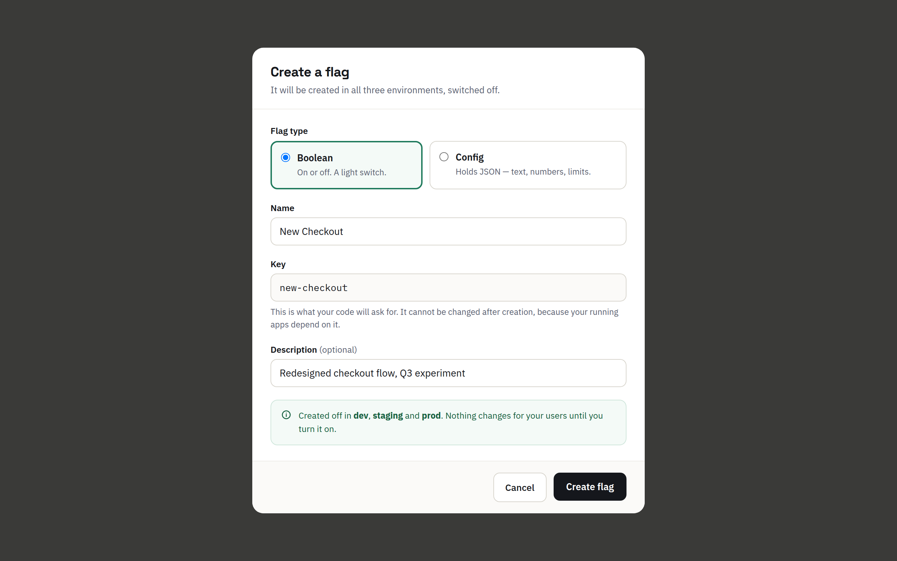
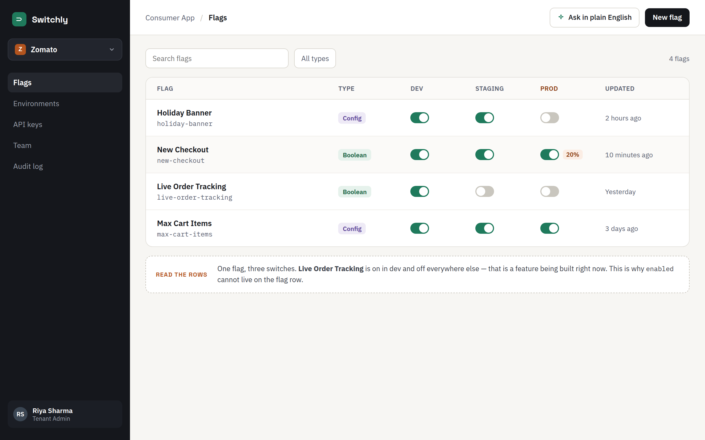

# Session 3B — Spring Boot meets Postgres

**Previous:** [Session 3A — A real database: Postgres in Docker](03A-postgres-in-docker.md)

In session 3A you created tables by hand and typed the SQL yourself. Today your session 2 API starts using that database.

**Same endpoints. Same `curl` commands. Same responses.** The only difference: stop the app, start it again, and your data is still there.

|                                     | Session 2         | After today                    |
| ----------------------------------- | ----------------- | ------------------------------ |
| Where the data lives                | A `Map` in memory | Postgres                       |
| Who creates the tables              | —                 | **Flyway**, from a `.sql` file |
| Who writes the SQL to save and find | —                 | **Spring Data JPA**            |
| Your controllers and services       | —                 | **Unchanged**                  |

**Before you start:** your `api` code should match the end of [session 2](02-spring-boot-in-memory-api.md#your-final-structure), and you should have finished [session 3A](03A-postgres-in-docker.md).

You'll use **two terminals** today:

- **Terminal 1** — runs the app, inside the `api` folder.
- **Terminal 2** — for `curl` and `psql`, inside the `infra` folder.

---

## Step 1 — Start Postgres and clear yesterday's tables

In **terminal 2**, from the `switchly` folder:

```bash
cd infra
docker compose up -d
docker compose exec postgres psql -U switchly -d switchly
```

In psql, delete the three tables you made by hand in session 3A:

```sql
DROP TABLE flag;
DROP TABLE project;
DROP TABLE organization;
```

```
DROP TABLE
DROP TABLE
DROP TABLE
```

> **Why in this order?** `flag` points at `project` and `organization`, and `project` points at `organization`. If you try to drop `organization` first, Postgres refuses:
>
> ```
> ERROR:  cannot drop table organization because other objects depend on it
> ```
>
> Drop the tables that point at others first.

Check:

```sql
\dt
```

```
Did not find any relations.
```

Quit psql with `\q`, but **leave Postgres running**.

**Why delete them?** Typing tables by hand worked for one laptop, once. Today the app learns to build the tables **itself**, from a file in your repository. The first time it does that, it wants an empty database.

---

## Step 2 — The problem Flyway solves

Imagine 40 students. Each of you typed the `CREATE TABLE` statements by hand. Some of you made a typo. Some of you skipped `NOT NULL`. Next week, we need to **change** the `flag` table. How does every laptop end up with exactly the same tables?

And later, when Switchly runs on a real server, how does **that** database get the same tables, and the same changes, in the same order?

The answer: **put the SQL in files, in the repository, and let a tool run them.**

- A **migration** is one `.sql` file that changes the database — create a table, add a column.
- **Flyway** is the tool that runs them. Every time the app starts, Flyway:
  1. looks at the migration files in your project,
  2. checks which ones have already run on **this** database,
  3. runs only the new ones, **in order**, and
  4. writes down what it ran, in a table called `flyway_schema_history`.

Every laptop — and later, the real server — runs the same files in the same order, so every database ends up identical.

> **The one rule of migrations:** once a migration has run, **never edit it**. To change something, write a **new** migration. You'll see why in Step 8.

---

## Step 3 — Add four dependencies

Open `api/pom.xml`. Find the `<dependencies>` section, and the `spring-boot-starter-webmvc` dependency inside it. **Right after it**, add these four:

```xml
		<dependency>
			<groupId>org.springframework.boot</groupId>
			<artifactId>spring-boot-starter-data-jpa</artifactId>
		</dependency>
		<dependency>
			<groupId>org.springframework.boot</groupId>
			<artifactId>spring-boot-starter-flyway</artifactId>
		</dependency>
		<dependency>
			<groupId>org.flywaydb</groupId>
			<artifactId>flyway-database-postgresql</artifactId>
		</dependency>
		<dependency>
			<groupId>org.postgresql</groupId>
			<artifactId>postgresql</artifactId>
			<scope>runtime</scope>
		</dependency>
```

| Dependency                     | What it gives you                                                                  |
| ------------------------------ | ---------------------------------------------------------------------------------- |
| `spring-boot-starter-data-jpa` | **JPA** — saves Java objects into tables and reads them back. Explained in Step 9. |
| `spring-boot-starter-flyway`   | **Flyway** — runs your migration files when the app starts.                        |
| `flyway-database-postgresql`   | Teaches Flyway how to talk to Postgres specifically.                               |
| `postgresql`                   | The **driver** — the small library Java uses to connect to Postgres.               |

No version numbers — Spring Boot picks versions that work together.

> **Careful with older tutorials.** Many tutorials add only `flyway-core`. With Spring Boot 4 that's **not enough** — Flyway silently never runs. You need `spring-boot-starter-flyway`, exactly as above.

**Tell your editor about the change:**

- **IntelliJ:** a small Maven icon appears at the top right of `pom.xml` — click it (**Load Maven Changes**). Or open the **Maven** panel on the right and click the reload button.
- **VS Code:** if it asks _"A build file was modified. Do you want to synchronize the Java classpath?"_, click **Yes** (or **Always**).

---

## Step 4 — Tell Spring where the database is

Replace everything in `api/src/main/resources/application.yaml` with:

```yaml
spring:
  application:
    name: api
  datasource:
    url: jdbc:postgresql://localhost:15432/switchly
    username: switchly
    password: switchly
  jpa:
    hibernate:
      ddl-auto: validate
    open-in-view: false
```

| Line                                              | Meaning                                                                                                                                                                             |
| ------------------------------------------------- | ----------------------------------------------------------------------------------------------------------------------------------------------------------------------------------- |
| `url: jdbc:postgresql://localhost:15432/switchly` | Connect to Postgres on **this laptop**, door **15432**, database **switchly**. The same door from your `docker-compose.yml`.                                                        |
| `username` / `password`                           | The ones from your `docker-compose.yml`.                                                                                                                                            |
| `ddl-auto: validate`                              | JPA could create tables by itself. **We don't let it** — Flyway owns the tables. JPA only **checks** that your Java classes match them. You'll see this check in action in Step 13. |
| `open-in-view: false`                             | Switches off a JPA feature we don't use. Without this line, Spring prints a warning every time it starts.                                                                           |

> **Changed the port in session 3A?** If you used `25432` (or anything else) in `docker-compose.yml`, use the same number in this `url`.

Don't start the app yet — first, the migration.

---

## Step 5 — Write your first migration

Flyway looks for migrations in one specific folder. Inside `api/src/main/resources/`, create a folder `db`, and inside it a folder `migration`:

```
api/src/main/resources/
├── application.yaml
└── db/
    └── migration/        ← new
```

Inside `migration`, create a file named **exactly**:

```
V1__create_organization_project_flag.sql
```

The name has four parts, and Flyway is strict about them:

| Part                               | Meaning                                                                   |
| ---------------------------------- | ------------------------------------------------------------------------- |
| `V1`                               | Version 1. The next migration will be `V2`, then `V3`.                    |
| `__`                               | **Two** underscores. One underscore and Flyway silently ignores the file. |
| `create_organization_project_flag` | A description, for humans. Underscores become spaces in Flyway's log.     |
| `.sql`                             | It's SQL.                                                                 |

Put this in the file — it's the **same SQL** you typed in session 3A, Step 8:

```sql
CREATE TABLE organization (
    id    UUID PRIMARY KEY,
    name  TEXT NOT NULL
);

CREATE TABLE project (
    id               UUID PRIMARY KEY,
    organization_id  UUID NOT NULL REFERENCES organization(id),
    name             TEXT NOT NULL
);

CREATE TABLE flag (
    id               UUID PRIMARY KEY,
    organization_id  UUID NOT NULL REFERENCES organization(id),
    project_id       UUID NOT NULL REFERENCES project(id),
    key              TEXT NOT NULL,
    name             TEXT NOT NULL,
    enabled          BOOLEAN NOT NULL DEFAULT false,
    CONSTRAINT uq_flag_key_per_project UNIQUE (project_id, key)
);
```

---

## Step 6 — Run it, and watch Flyway work

In **terminal 1**, inside the `api` folder:

```bash
./mvnw spring-boot:run        # macOS / Linux
mvnw.cmd spring-boot:run      # Windows
```

The first run downloads the new dependencies, so give it a minute. In the log, look for these lines from Flyway (each line starts with a date and more — look at the end):

```
Database: jdbc:postgresql://localhost:15432/switchly (PostgreSQL 17.11)
Creating Schema History table "public"."flyway_schema_history" ...
Current version of schema "public": << Empty Schema >>
Migrating schema "public" to version "1 - create organization project flag"
Successfully applied 1 migration to schema "public", now at version v1
```

and finally, as always:

```
Started SwitchlyApiApplication in 2.2 seconds
```

**Flyway just created your three tables.** Check — in **terminal 2**, open psql:

```bash
docker compose exec postgres psql -U switchly -d switchly
```

```sql
\dt
```

```
                 List of relations
 Schema |         Name          | Type  |  Owner
--------+-----------------------+-------+----------
 public | flag                  | table | switchly
 public | flyway_schema_history | table | switchly
 public | organization          | table | switchly
 public | project               | table | switchly
(4 rows)
```

Your three tables — and a fourth one, Flyway's notebook. Look inside it:

```sql
SELECT version, description, script, success FROM flyway_schema_history;
```

```
 version |           description            |                  script                  | success
---------+----------------------------------+------------------------------------------+---------
 1       | create organization project flag | V1__create_organization_project_flag.sql | t
(1 row)
```

"Version 1 ran, from this file, and it worked."

### Run it again

In **terminal 1**, stop the app (`Ctrl + C`) and start it again. This time Flyway says:

```
Schema "public" is up to date. No migration necessary.
```

V1 already ran on this database, so Flyway doesn't run it again. That's how it can run on **every** start without ever creating a table twice.

---

## Step 7 — A puzzle

The app is running and connected to Postgres. Create an organization, exactly like in session 2. In **terminal 2** (quit psql first with `\q`):

```bash
curl -i -X POST http://localhost:8080/api/v1/orgs \
  -H "Content-Type: application/json" \
  -d '{"name": "Zomato"}'
```

```
HTTP/1.1 201
{"id":"204aba55-…","name":"Zomato"}
```

201 Created. Now look in the database:

```bash
docker compose exec postgres psql -U switchly -d switchly
```

```sql
SELECT * FROM organization;
```

```
 id | name
----+------
(0 rows)
```

**Empty.** Where did Zomato go?

_Think about it for a minute before reading on._

Look at `OrganizationService` from session 2. It calls `organizationRepository.save(...)`. And the only class that implements `OrganizationRepository` is still… `InMemoryOrganizationRepository` — a `Map`.

> **Connecting to a database doesn't move your data into it. The repository decides where data goes** — and ours still puts it in a `Map`.

Next, we change that. But first, one experiment with Flyway.

Quit psql (`\q`).

---

## Step 8 — Break Flyway (on purpose)

Stop the app (`Ctrl + C` in terminal 1).

Now do the thing the rule says never to do: **edit V1** after it has run. In `V1__create_organization_project_flag.sql`, add a `city` column to `organization`:

```sql
CREATE TABLE organization (
    id    UUID PRIMARY KEY,
    name  TEXT NOT NULL,
    city  TEXT
);
```

Start the app. It **fails**, with a long error. Don't panic at the length.

> **How to read a long error.** Java errors are long because they list every method that was running — the lines starting with `at …`. Skip those. Look for lines that read like **English**, usually near a `Caused by:`.

Somewhere in it, you'll find:

```
Validate failed: Migrations have failed validation
Migration checksum mismatch for migration version 1
-> Applied to database : 1307217015
-> Resolved locally    : 116899386
Either revert the changes to the migration, or run repair to update the schema history.
```

When Flyway runs a file, it saves a **checksum** — a number calculated from the file's contents, like a fingerprint. On every start, it recalculates the fingerprints. If a file that already ran has a different fingerprint, Flyway stops: _"the database was built from a file that no longer exists. I don't know what state it's in."_

Your database doesn't have a `city` column — V1 already ran without it. Editing the file can't change the past.

**The right way** to add a column is a **new** migration — `V2__add_city_to_organization.sql` with an `ALTER TABLE`. You'll do exactly that in the homework.

Now **undo your edit** — remove the `city` line and the comma after `NOT NULL`, so the file is exactly as it was. Start the app again. It starts normally.

---

## Step 9 — Organization: from `Map` to table

Time to make the repository use Postgres. We'll use **JPA**.

> **JPA** (Jakarta Persistence) is the standard Java way to save objects into tables and read them back. You put a few annotations on a class to say _"this class is a table, this field is that column"_. **Spring Data JPA** goes one step further: you write only the repository **interface**, and Spring writes the code behind it.
>
> You'll also see the name **Hibernate** in your logs. That's the library doing the actual work underneath JPA.

We'll do `Organization` first, all the way through. Then `Project` and `Flag` are the same three moves.

### 9.1 Model — `model/Organization.java`

Replace the whole file with:

```java
package live.switchly.api.model;

import jakarta.persistence.Column;
import jakarta.persistence.Entity;
import jakarta.persistence.Id;
import jakarta.persistence.Table;

import java.util.UUID;

@Entity
@Table(name = "organization")
public class Organization {

    @Id
    @Column(name = "id")
    private UUID id;

    @Column(name = "name")
    private String name;

    protected Organization() {
        // JPA needs this. It creates an empty object, then fills in the fields from the row.
    }

    public Organization(UUID id, String name) {
        this.id = id;
        this.name = name;
    }

    public UUID getId() { return id; }
    public String getName() { return name; }
}
```

What's new:

| Code                            | Meaning                                             |
| ------------------------------- | --------------------------------------------------- |
| `@Entity`                       | "Objects of this class are saved in a table."       |
| `@Table(name = "organization")` | "…in the table called `organization`."              |
| `@Id`                           | "This field is the primary key."                    |
| `@Column(name = "name")`        | "This field is stored in the column called `name`." |

And two changes you might not notice:

1. **The fields are no longer `final`.** Look at the next point to see why.
2. **A new, empty constructor: `protected Organization()`.** When JPA reads a row from the database, it can't call `new Organization(id, name)` — it doesn't know which constructor argument is which. So it calls the **empty** constructor, then puts the values straight into the fields. That's why the fields can't be `final`: a `final` field can't be filled in later.

   It's `protected` so that **your** code keeps using the real constructor. Only JPA uses the empty one.

### 9.2 Repository — `repository/OrganizationRepository.java`

Replace the whole file with:

```java
package live.switchly.api.repository;

import live.switchly.api.model.Organization;
import org.springframework.data.jpa.repository.JpaRepository;

import java.util.UUID;

public interface OrganizationRepository extends JpaRepository<Organization, UUID> {
}
```

`JpaRepository<Organization, UUID>` means _"a repository for `Organization` objects, whose id is a `UUID`"_.

The body is **empty** — where did `save`, `findById` and `findAll` go? `JpaRepository` already has them (and more: `deleteById`, `existsById`, `count`…). We don't need to write them again.

### 9.3 Delete `repository/InMemoryOrganizationRepository.java`

Yes, delete it. (**IntelliJ:** right-click the file → **Delete**. **VS Code:** right-click → **Delete**.)

So who implements `OrganizationRepository` now? **Spring does.** When the app starts, Spring sees an interface that extends `JpaRepository`, and writes a class for it, with real SQL inside. You never see that class — but you'll see its SQL in Step 12.

### 9.4 `OrganizationService` — don't touch it

Open it and look. It calls `organizationRepository.save(...)`, `.findById(...)` and `.findAll()`. All three exist on `JpaRepository`, with the same names. Nothing to change.

### 9.5 Try it

Restart the app (`Ctrl + C`, then `./mvnw spring-boot:run`). In the log, you'll see Spring found your repository:

```
Found 1 JPA repository interface.
```

In **terminal 2**:

```bash
curl -X POST http://localhost:8080/api/v1/orgs \
  -H "Content-Type: application/json" -d '{"name": "Zomato"}'
```

```bash
docker compose exec postgres psql -U switchly -d switchly -c "SELECT * FROM organization;"
```

```
                  id                  |  name
--------------------------------------+--------
 35277386-0dca-42a5-91d8-352ed05a55ad | Zomato
(1 row)
```

**It's in the database.** (The `-c "…"` runs one SQL statement and exits — handy when you just want a quick look.)

Now the moment session 2 was missing. Stop the app. Start it again. Then:

```bash
curl http://localhost:8080/api/v1/orgs
```

```
[{"id":"35277386-…","name":"Zomato"}]
```

**Zomato survived the restart.** 🎉

> **Did you do the session 2 homework?** If you added methods like `deleteById` or `existsById` to any repository interface, delete those lines when you convert it — `JpaRepository` already has them, and declaring them again with a different return type won't compile.

---

## Step 10 — Project: the same three moves

### `model/Project.java`

```java
package live.switchly.api.model;

import jakarta.persistence.Column;
import jakarta.persistence.Entity;
import jakarta.persistence.Id;
import jakarta.persistence.Table;

import java.util.UUID;

@Entity
@Table(name = "project")
public class Project {

    @Id
    @Column(name = "id")
    private UUID id;

    @Column(name = "organization_id")
    private UUID organizationId;

    @Column(name = "name")
    private String name;

    protected Project() {
        // for JPA
    }

    public Project(UUID id, UUID organizationId, String name) {
        this.id = id;
        this.organizationId = organizationId;
        this.name = name;
    }

    public UUID getId() { return id; }
    public UUID getOrganizationId() { return organizationId; }
    public String getName() { return name; }
}
```

Notice `@Column(name = "organization_id")` on the field `organizationId`. Java says `camelCase`, SQL says `snake_case` — this line connects the two.

> **Why not `Organization organization` instead of `UUID organizationId`?** JPA _can_ do that — link objects to objects. It's powerful, and it's also where most JPA bugs come from. We keep it simple: a project stores its organization's **id**, exactly like the table does. Same as session 2.

### `repository/ProjectRepository.java`

```java
package live.switchly.api.repository;

import live.switchly.api.model.Project;
import org.springframework.data.jpa.repository.JpaRepository;

import java.util.List;
import java.util.UUID;

public interface ProjectRepository extends JpaRepository<Project, UUID> {

    List<Project> findByOrganizationId(UUID organizationId);
}
```

This time one method stays: `findByOrganizationId`. `JpaRepository` doesn't have it — it's specific to us. But you still don't write the code for it.

**Spring reads the method's name** and turns it into SQL:

```
find…By  OrganizationId
   │          │
   │          └──►  WHERE organization_id = ?
   └──►  SELECT … FROM project
```

You named this method in session 2, in a way that happens to be exactly what Spring Data understands. That's not luck — it's the standard naming style, and now it pays off.

### Delete `repository/InMemoryProjectRepository.java`

---

## Step 11 — Flag: the same three moves

### `model/Flag.java`

```java
package live.switchly.api.model;

import jakarta.persistence.Column;
import jakarta.persistence.Entity;
import jakarta.persistence.Id;
import jakarta.persistence.Table;

import java.util.UUID;

@Entity
@Table(name = "flag")
public class Flag {

    @Id
    @Column(name = "id")
    private UUID id;

    @Column(name = "organization_id")
    private UUID organizationId;

    @Column(name = "project_id")
    private UUID projectId;

    @Column(name = "key")
    private String key;

    @Column(name = "name")
    private String name;

    @Column(name = "enabled")
    private boolean enabled;

    protected Flag() {
        // for JPA
    }

    public Flag(UUID id, UUID organizationId, UUID projectId, String key, String name, boolean enabled) {
        this.id = id;
        this.organizationId = organizationId;
        this.projectId = projectId;
        this.key = key;
        this.name = name;
        this.enabled = enabled;
    }

    public UUID getId() { return id; }
    public UUID getOrganizationId() { return organizationId; }
    public UUID getProjectId() { return projectId; }
    public String getKey() { return key; }
    public String getName() { return name; }
    public boolean isEnabled() { return enabled; }

    public void setEnabled(boolean enabled) { this.enabled = enabled; }
}
```

`setEnabled` stays. `FlagService.setEnabled` changes the field, then calls `save` — and JPA turns that into an `UPDATE`.

### `repository/FlagRepository.java`

```java
package live.switchly.api.repository;

import live.switchly.api.model.Flag;
import org.springframework.data.jpa.repository.JpaRepository;

import java.util.List;
import java.util.UUID;

public interface FlagRepository extends JpaRepository<Flag, UUID> {

    List<Flag> findByProjectId(UUID projectId);

    boolean existsByProjectIdAndKey(UUID projectId, String key);
}
```

`existsByProjectIdAndKey` → _"does any flag exist WHERE project_id = ? AND key = ?"_. Again, a name you wrote in session 2.

### Delete `repository/InMemoryFlagRepository.java`

Your `repository` folder now has **three interfaces and nothing else**:

```
repository/
├── FlagRepository.java
├── OrganizationRepository.java
└── ProjectRepository.java
```

Restart the app. The log now says:

```
Found 3 JPA repository interfaces.
```

---

## Step 12 — See the SQL Spring writes for you

So far, Spring has been writing SQL behind your back. Let's make it show us.

In `application.yaml`, add `show-sql: true` under `jpa`:

```yaml
jpa:
  hibernate:
    ddl-auto: validate
  open-in-view: false
  show-sql: true
```

Keep the indentation: `show-sql` lines up with `open-in-view`.

Restart the app. Now create a project and a flag (use your own organization id from Step 9 — get it with `curl http://localhost:8080/api/v1/orgs`):

```bash
curl -X POST http://localhost:8080/api/v1/orgs/PASTE_ORG_ID/projects \
  -H "Content-Type: application/json" -d '{"name": "Consumer App"}'
```

```bash
curl -X POST http://localhost:8080/api/v1/projects/PASTE_PROJECT_ID/flags \
  -H "Content-Type: application/json" -d '{"key": "new-checkout", "name": "New Checkout"}'
```

Now look at **terminal 1**. For the flag, you'll see something like:

```
Hibernate: select p1_0.id,p1_0.name,p1_0.organization_id from project p1_0 where p1_0.id=?
Hibernate: select f1_0.id from flag f1_0 where f1_0.project_id=? and f1_0.key=? fetch first ? rows only
Hibernate: select f1_0.id,f1_0.enabled,f1_0.key,f1_0.name,f1_0.organization_id,f1_0.project_id from flag f1_0 where f1_0.id=?
Hibernate: insert into flag (enabled,key,name,organization_id,project_id,id) values (?,?,?,?,?,?)
```

Read them one by one, against `FlagService.create` from session 2:

| Line | Comes from                                |                                                                           |
| ---- | ----------------------------------------- | ------------------------------------------------------------------------- |
| 1    | `projectService.getById(projectId)`       | Does the project exist? (→ 404 if not)                                    |
| 2    | `existsByProjectIdAndKey(projectId, key)` | **The SQL Spring wrote from your method name.** (→ 409 if a row is found) |
| 3    | `flagRepository.save(flag)`               | Explained below.                                                          |
| 4    | `flagRepository.save(flag)`               | The actual `INSERT`.                                                      |

A few things to notice:

- `p1_0` and `f1_0` are just short names Hibernate gives the tables — like the `p` and `f` you used in your JOIN in session 3A.
- `?` marks a value that's sent **separately** from the SQL. The values are never pasted into the SQL text. That's an important safety feature — you'll learn why it matters when we talk about security.
- **Why a `select` before the `insert` (line 3)?** In session 2, _we_ give each flag its id (`UUID.randomUUID()`), before saving it. So when `save` receives a flag that already has an id, Spring can't tell whether it's new or already in the database — so it asks the database first. Nothing found → `INSERT`. It's harmless; just one extra quick query.

Now turn the flag on (use your flag's id):

```bash
curl -X PUT http://localhost:8080/api/v1/flags/PASTE_FLAG_ID/state \
  -H "Content-Type: application/json" -d '{"enabled": true}'
```

```
Hibernate: select f1_0.id,f1_0.enabled,f1_0.key,f1_0.name,f1_0.organization_id,f1_0.project_id from flag f1_0 where f1_0.id=?
Hibernate: select f1_0.id,f1_0.enabled,f1_0.key,f1_0.name,f1_0.organization_id,f1_0.project_id from flag f1_0 where f1_0.id=?
Hibernate: update flag set enabled=?,key=?,name=?,organization_id=?,project_id=? where id=?
```

`getById` reads the flag. `save` checks it (the same "is it new?" question — this time the row exists), and then runs an **`UPDATE`**. That's your `PUT .../state`, exactly like the `UPDATE flag SET enabled = true` you typed by hand in session 3A.

> **Keep `show-sql: true` on** for now. Whenever something surprises you, the SQL in the log is the first place to look.

---

## Step 13 — The safety check: `validate` (break it on purpose)

In Step 4 you set `ddl-auto: validate`. When the app starts, JPA compares every `@Entity` class with the real tables. Let's see it catch a mistake.

Stop the app. In `Flag.java`, change the name column to one that doesn't exist:

```java
    @Column(name = "flag_name")
    private String name;
```

Start the app. It fails. Look for:

```
Schema validation: missing column [flag_name] in table [flag]
```

JPA checked your class against the table, found a column that doesn't exist, and **refused to start**. That's what you want: a mistake caught the moment you start the app on your laptop — not when a customer clicks a button.

**Undo it** — change `"flag_name"` back to `"name"` — and start the app again.

---

## Step 14 — The whole flow, again

This is session 2's Step 9, unchanged. Run it in order, replacing the `PASTE_…` values with the ids from each response:

```bash
# 1. Create an organization
curl -X POST http://localhost:8080/api/v1/orgs \
  -H "Content-Type: application/json" -d '{"name": "Swiggy"}'

# 2. Create a project in it
curl -X POST http://localhost:8080/api/v1/orgs/PASTE_ORG_ID/projects \
  -H "Content-Type: application/json" -d '{"name": "Swiggy App"}'

# 3. Create a flag in the project — it starts OFF
curl -X POST http://localhost:8080/api/v1/projects/PASTE_PROJECT_ID/flags \
  -H "Content-Type: application/json" -d '{"key": "surge-pricing", "name": "Surge Pricing"}'

# 4. Turn it ON
curl -X PUT http://localhost:8080/api/v1/flags/PASTE_FLAG_ID/state \
  -H "Content-Type: application/json" -d '{"enabled": true}'

# 5. Check it
curl http://localhost:8080/api/v1/flags/PASTE_FLAG_ID
```

Step 5 shows `"enabled":true`.

Try to break it, exactly like session 2. You get the same answers:

- Create the same flag key twice in one project → **409**
- Create a flag with the key `New Checkout` → **400**
- Turn on a flag ID that doesn't exist → **404**

### The real test: restart

Stop the app. Start it. Run step 5 again:

```bash
curl http://localhost:8080/api/v1/flags/PASTE_FLAG_ID
```

```
{"id":"…","organizationId":"…","projectId":"…","key":"surge-pricing","name":"Surge Pricing","enabled":true}
```

**Still there. Still on.** Compare that with the last step of session 2.

And look at everything in the database — the same JOIN from session 3A:

```bash
docker compose exec postgres psql -U switchly -d switchly
```

```sql
SELECT o.name AS organization, p.name AS project, f.key, f.enabled
FROM flag f
JOIN project p      ON p.id = f.project_id
JOIN organization o ON o.id = f.organization_id;
```

```
 organization |   project    |      key      | enabled
--------------+--------------+---------------+---------
 Zomato       | Consumer App | new-checkout  | t
 Swiggy       | Swiggy App   | surge-pricing | t
(2 rows)
```

Rows **your API** wrote.

---

## Step 15 — What changed, and what didn't

|               | Files                                                                                            |
| ------------- | ------------------------------------------------------------------------------------------------ |
| **Changed**   | `pom.xml`, `application.yaml`, the 3 models, the 3 repository interfaces                         |
| **New**       | `db/migration/V1__create_organization_project_flag.sql` (and `infra/docker-compose.yml` from 3A) |
| **Deleted**   | The 3 `InMemory…Repository` classes                                                              |
| **Unchanged** | **Every controller. Every service. Every DTO. Every exception.**                                 |

At the end of session 2 we said:

> _Because the service only knows about `OrganizationRepository`, the service and controller won't change at all._

**That promise just came true.** We replaced where the data lives, and the rest of the app didn't notice. That's what an interface is for.

---

## Step 16 — Tests now need the database

Run the tests from session 2:

```bash
./mvnw test
```

With Postgres running, you'll see `BUILD SUCCESS`. But if Postgres is **stopped**, the test fails with:

```
Connection to localhost:15432 refused. Check that the hostname and port are correct and that the postmaster is accepting TCP/IP connections.
```

The only test we have starts the whole app — and the app now needs its database. So: **start Postgres before running tests** (`docker compose up -d` in `infra`). In a later session, the tests will start their own database automatically.

---

## Your final structure

```
switchly/
├── api/
│   ├── pom.xml                                    ← 4 new dependencies
│   └── src/main/
│       ├── java/live/switchly/api/
│       │   ├── SwitchlyApiApplication.java
│       │   ├── controller/                        (unchanged)
│       │   ├── dto/                               (unchanged)
│       │   ├── exception/                         (unchanged)
│       │   ├── model/
│       │   │   ├── Organization.java              ← @Entity
│       │   │   ├── Project.java                   ← @Entity
│       │   │   └── Flag.java                      ← @Entity
│       │   ├── repository/
│       │   │   ├── OrganizationRepository.java    ← extends JpaRepository
│       │   │   ├── ProjectRepository.java         ← extends JpaRepository
│       │   │   └── FlagRepository.java            ← extends JpaRepository
│       │   └── service/                           (unchanged)
│       └── resources/
│           ├── application.yaml                   ← database settings
│           └── db/migration/
│               └── V1__create_organization_project_flag.sql   ← new
├── docs/
└── infra/
    └── docker-compose.yml
```

---

## New words

| Word                     | Meaning                                                                                                     |
| ------------------------ | ----------------------------------------------------------------------------------------------------------- |
| **Migration**            | One `.sql` file that changes the database. Numbered, run once, in order, never edited after it runs.        |
| **Flyway**               | The tool that runs migrations when the app starts, and remembers which ones it ran.                         |
| **Checksum**             | A fingerprint of a file's contents. Flyway uses it to notice edited migrations.                             |
| **Driver**               | The small library Java uses to connect to a specific database.                                              |
| **JPA**                  | The standard Java way to save objects into tables and read them back.                                       |
| **Hibernate**            | The library that does JPA's work underneath. Its name appears in your logs.                                 |
| **Entity**               | A class marked `@Entity` — its objects are rows in a table.                                                 |
| **Spring Data JPA**      | Writes the code behind your repository interfaces — including SQL from method names like `findByProjectId`. |
| **`ddl-auto: validate`** | At startup, check every entity against the real tables. Never create or change tables.                      |

---

## If something goes wrong

| You see                                                                                                                                                      | Fix                                                                                                                                                                                              |
| ------------------------------------------------------------------------------------------------------------------------------------------------------------ | ------------------------------------------------------------------------------------------------------------------------------------------------------------------------------------------------ |
| `Connection to localhost:15432 refused`                                                                                                                      | Postgres isn't running. In `infra`: `docker compose up -d`. Also check Docker Desktop is open.                                                                                                   |
| `password authentication failed for user "switchly"` or `role "switchly" does not exist`                                                                     | Your `url` has the wrong port — you reached a **different** Postgres (probably one installed on your laptop). The port in `application.yaml` must match the left number in `docker-compose.yml`. |
| `Found non-empty schema(s) "public" but no schema history table`                                                                                             | You didn't drop the hand-made tables from session 3A. Do Step 1, then start the app again.                                                                                                       |
| `Schema validation: missing table [flag]`, and the log says `1 SQL migrations were detected but not run because they did not follow the filename convention` | The migration file name is wrong. It must be `V1__…sql` — capital `V`, **two** underscores. Then run `./mvnw clean` and start again (the old wrong file may still be in `target`).               |
| `Schema validation: missing table [flag]`, and **no** lines from Flyway in the log at all                                                                    | Flyway isn't running. Check you added `spring-boot-starter-flyway` (not only `flyway-core`), and that the file is in `src/main/resources/db/migration/` — check every folder name.               |
| `Schema validation: missing column [...] in table [...]`                                                                                                     | An `@Column(name = "...")` doesn't match the column in your migration. Compare them letter by letter.                                                                                            |
| `Migration checksum mismatch for migration version 1`                                                                                                        | You edited V1 after it ran. Undo your edit exactly. (If you really can't get it back, see the note below.)                                                                                       |
| `Not a managed type: class live.switchly.api.model.…`                                                                                                        | You forgot `@Entity` on that class.                                                                                                                                                              |
| `No property 'remove' found for type 'Flag'` (or another name)                                                                                               | A repository interface still has a method Spring can't turn into SQL — often left over from the session 2 homework. Delete it, and use what `JpaRepository` already has, like `deleteById`.      |
| `variable id might not have been initialized`                                                                                                                | A field is still `final`. Remove `final` from the fields of your entities.                                                                                                                       |
| The app starts, but a request returns **500**, and the log says `No default constructor for entity`                                                          | You forgot the empty `protected …() {}` constructor in that entity.                                                                                                                              |
| `cannot find symbol: class Entity` / `package jakarta.persistence does not exist`                                                                            | The new dependencies aren't loaded. Reload Maven in your editor (Step 3), or run from the terminal with `./mvnw spring-boot:run`.                                                                |
| `cannot drop table organization because other objects depend on it`                                                                                          | Drop the tables in order: `flag`, then `project`, then `organization`.                                                                                                                           |
| A `WARN` about `spring.jpa.open-in-view` when the app starts                                                                                                 | You missed `open-in-view: false` in `application.yaml`. Harmless, but add it.                                                                                                                    |
| `./mvnw test` fails with `Connection … refused`                                                                                                              | Start Postgres first (Step 16).                                                                                                                                                                  |

> **Totally stuck with your database?** On your laptop, you can always start from zero: stop the app, then in `infra` run `docker compose down -v` and `docker compose up -d`. That **deletes all your data**. Start the app, and Flyway builds every table again from your migration files. (This is exactly why the migration files matter — they can rebuild the database from nothing.) **Never do this on a real server.**

---

## Homework

1. **Add a description — properly.** Our create-flag screen has an optional description:

   

   Add an optional `description` to flags, through a **new migration**:
   - Create `V2__add_flag_description.sql` with:
     ```sql
     ALTER TABLE flag ADD COLUMN description TEXT;
     ```
     (No `NOT NULL` — it's optional, and the flags that already exist don't have one.)
   - Add a `description` field to `Flag` with `@Column(name = "description")`, a getter, and a new constructor parameter.
   - Make `description` an optional field in `CreateFlagRequest`, and pass it through `FlagController` and `FlagService.create`.

   Start the app: the log should say `now at version v2`. Check `SELECT version, script FROM flyway_schema_history;` — two rows now. Create a flag with a description, restart, and check it's still there.

   Then answer: **which files did you touch?** Compare with the session 2 homework, when you added the same thing to the in-memory version.

2. **Find the SQL.** With `show-sql: true` on, call `GET /api/v1/orgs/PASTE_ORG_ID/projects`. Find the line in the log that came from `findByOrganizationId`. Copy it into your notes.

3. **Predict the SQL.** One of our design screens shows this line of code — it's how session 8 will stop one company from reading another company's flag:

   

   ```java
   repo.findByIdAndOrganizationId(flagId, orgId)
   ```

   Without running anything, write the SQL you think Spring would generate for this method name.

   <details>
   <summary>Answer</summary>

   Something like:

   ```sql
   select f1_0.id, f1_0.enabled, f1_0.key, f1_0.name, f1_0.organization_id, f1_0.project_id
   from flag f1_0
   where f1_0.id=? and f1_0.organization_id=?
   ```

   `find…By` + `Id` + `And` + `OrganizationId`. The `and f1_0.organization_id=?` is the keycard from session 3A — and you can now read it straight from the method name.
   </details>

---

## Checkpoint

- ✅ The first time the app starts on an empty database, the log says `Successfully applied 1 migration`. After that, it says `up to date`.
- ✅ You can create an organization → project → flag, turn the flag on, **restart the app**, and it's all still there.
- ✅ Your `repository` folder has three interfaces and no `InMemory…` classes.
- ✅ You can explain what Flyway does, and why you never edit a migration that has already run.
- ✅ You can explain `@Entity`, `@Id`, `@Column`, and why entities need an empty constructor.
- ✅ You can point at the SQL Spring generated for `existsByProjectIdAndKey`.
- ✅ You can say which files changed today — and that no controller or service did.

---

## Coming up next

Look at this screen from our design:



One flag, **three switches** — dev, staging, prod. `Live Order Tracking` is on in dev and off everywhere else.

Our `flag` table has **one** `enabled` column. Remember the third homework question from session 2? _"A customer wants `new-checkout` on in their test environment but off for real users. What in your current design would have to change?"_ Next session, we answer it — with a new table, a new migration, and our first real change to a database that already has data in it.
